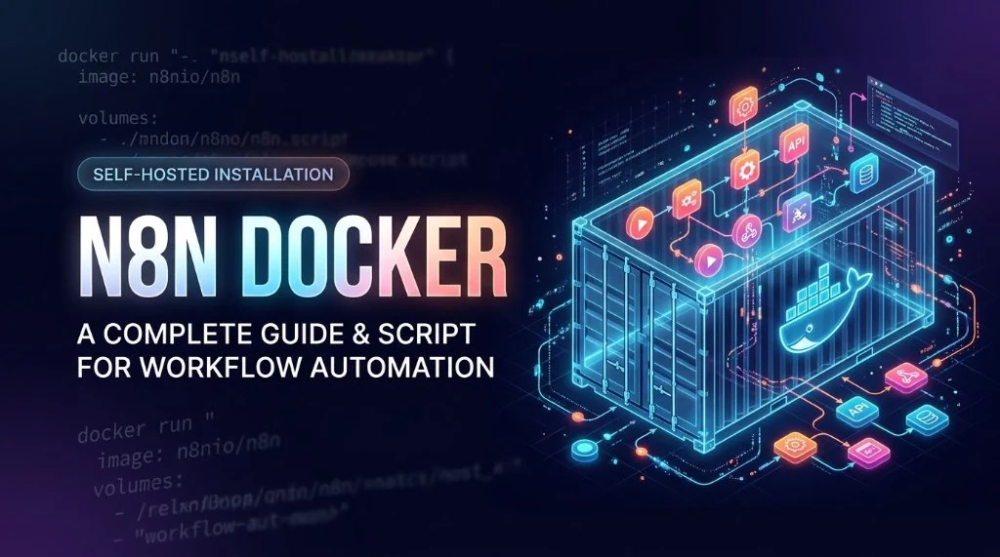

# Stack Universal n8n Docker (`n8n-docker.sh`)

🇺🇸 [English](README.md) | 🇧🇷 [Português (BR)](README-ptbr.md) | 🇪🇸 **Español**

[](LICENSE) [](https://github.com/sr00t3d/n8n-docker/releases) [](docker-compose.yml) [](n8n-docker.sh)



Stack **n8n autohospedada en Queue Mode** lista para producción e independiente de panel, impulsada por **PostgreSQL 17**, **Redis 7**, **workers escalables** y una CLI universal en Bash (`n8n-docker.sh`) compatible con **Docker Compose** o **Podman Compose** en cualquier servidor Linux — detrás de **Nginx**, **Caddy**, **Traefik**, **Cloudflare Tunnel**, **FastPanel**, **CloudPanel**, **Plesk**, **DirectAdmin** o **cPanel**.

## Características Principales

- **Universal e Independiente de Panel:** sin dependencia de un panel específico; enlaza n8n únicamente a `127.0.0.1:5678` (o puerto personalizado con `--port`) detrás de tu proxy inverso (plantillas listas en `proxies/nginx.conf` y `proxies/Caddyfile`).
- **Arquitectura Moderna en Queue Mode:** PostgreSQL 17 Alpine (con `pgcrypto` + `uuid-ossp` + usuario sin privilegios root), Redis 7 Alpine (con contraseña y persistencia AOF), instancia principal `n8n` y réplicas `n8n-worker` escalables (`--workers N`), ambos monitoreados mediante `healthcheck.js` en `/healthz`.
- **Generación Automática de Secretos (`--init`):** genera `N8N_ENCRYPTION_KEY`, contraseñas de PostgreSQL (root/app) y `REDIS_PASSWORD` criptográficamente fuertes en un archivo `.env` con permisos `chmod 600` (`--domain`, `--port`, `--tz`).
- **CLI Completa de Ciclo de Vida (`n8n-docker.sh`):** `--init`, `--status`/`--preflight` (`-o table|json|csv`), `--up`, `--down`, `--restart`, `--update`, `--logs`, `--backup` (respaldos limpios y comprimidos de PostgreSQL con `chmod 600`), `--install-systemd --workers <N>` y `--dry-run`.

## Inicio Rápido

```bash
git clone https://github.com/sr00t3d/n8n-docker.git
cd n8n-docker
chmod +x n8n-docker.sh init-data.sh

# 1. Generar .env con secretos aleatorios fuertes (chmod 600)
./n8n-docker.sh --init --domain n8n.example.com --port 5678 --tz America/Sao_Paulo

# 2. Auditar runtime, sintaxis Compose, permisos de .env y puerto configurado
./n8n-docker.sh --status

# 3. Iniciar PostgreSQL 17 + Redis 7 + n8n + 2 workers de cola
./n8n-docker.sh --up --workers 2

# 4. (Opcional) Instalar unidad systemd portátil para inicio automático
sudo ./n8n-docker.sh --install-systemd --workers 2
```

## Plantillas de Proxy Inverso

- **Nginx / FastPanel / CloudPanel / DirectAdmin / Plesk:** ver [proxies/nginx.conf](proxies/nginx.conf) (incluye cabeceras `Upgrade`/`Connection` para WebSocket y SSE).
- **Caddy (HTTPS automático con Let's Encrypt):** ver [proxies/Caddyfile](proxies/Caddyfile).

## Ejemplo de Salida Real

### Auditoría de la Stack (`./n8n-docker.sh --status --no-color`)

```text
=====================================================================
 n8n-docker.sh v2.0.0 | Universal n8n Stack Audit | 2026-11-20T23:59:20Z
=====================================================================
  OS             : AlmaLinux 8.10 (Cerulean Leopard)
  Runtime        : docker (docker compose)
  Compose Config : valid
  RAM / Disk Free: 11688 MB / 19 GB
  .env File      : present (permissions: 600)
  Port 5678      : free
```

### Salida Estructurada en JSON (`./n8n-docker.sh --status -o json`)

```json
{
  "tool": "n8n-docker.sh",
  "version": "2.0.0",
  "timestamp": "2026-11-20T23:59:20Z",
  "os": "AlmaLinux 8.10 (Cerulean Leopard)",
  "runtime": "docker",
  "compose_cmd": "docker compose",
  "compose_file_valid": "valid",
  "ram_mb": 11688,
  "disk_free_gb": 19,
  "env_file": "present",
  "env_perms": "600",
  "listen_port": 5678,
  "port_status": "free"
}
```

## Licencia

Licenciado bajo la [Apache License 2.0](LICENSE).
