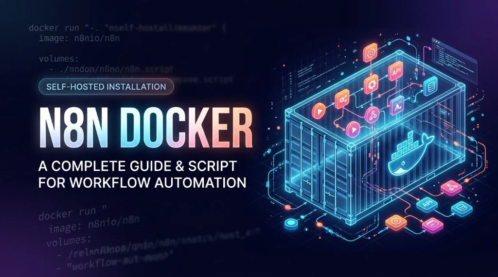

# Stack Universal n8n Docker (`n8n-docker.sh`)

🇺🇸 [English](README.md) | 🇧🇷 **Português (BR)** | 🇪🇸 [Español](README-es.md)

[](LICENSE) [](https://github.com/sr00t3d/n8n-docker/releases) [](docker-compose.yml) [](n8n-docker.sh)



Stack **n8n self-hosted em Queue Mode** pronta para produção e independente de painel, baseada em **PostgreSQL 17**, **Redis 7**, **workers escaláveis** e uma CLI universal em Bash (`n8n-docker.sh`) compatível com **Docker Compose** ou **Podman Compose** em qualquer servidor Linux — atrás de **Nginx**, **Caddy**, **Traefik**, **Cloudflare Tunnel**, **FastPanel**, **CloudPanel**, **Plesk**, **DirectAdmin** ou **cPanel**.

## Principais Recursos

- **Universal e Independente de Painel:** zero acoplamento a um painel específico; expõe o n8n apenas em `127.0.0.1:5678` (ou porta customizada via `--port`) atrás do seu proxy reverso (templates prontos em `proxies/nginx.conf` e `proxies/Caddyfile`).
- **Arquitetura Moderna em Queue Mode:** PostgreSQL 17 Alpine (com `pgcrypto` + `uuid-ossp` + usuário dedicado sem privilégios root), Redis 7 Alpine (com senha e persistência AOF), instância principal `n8n` e réplicas `n8n-worker` escaláveis (`--workers N`), ambos monitorados via `healthcheck.js` em `/healthz`.
- **Geração Automática de Segredos (`--init`):** gera `N8N_ENCRYPTION_KEY`, senhas PostgreSQL (root/app) e `REDIS_PASSWORD` criptograficamente fortes direto em um `.env` com permissão `chmod 600` (`--domain`, `--port`, `--tz`).
- **CLI Completa de Ciclo de Vida (`n8n-docker.sh`):** `--init`, `--status`/`--preflight` (`-o table|json|csv`), `--up`, `--down`, `--restart`, `--update`, `--logs`, `--backup` (dumps PostgreSQL limpos e compactados `chmod 600`), `--install-systemd --workers <N>` e `--dry-run`.

## Uso Rápido

```bash
git clone https://github.com/sr00t3d/n8n-docker.git
cd n8n-docker
chmod +x n8n-docker.sh init-data.sh

# 1. Gerar .env com segredos aleatórios fortes (chmod 600)
./n8n-docker.sh --init --domain n8n.example.com --port 5678 --tz America/Sao_Paulo

# 2. Auditar runtime, sintaxe Compose, permissões do .env e porta configurada
./n8n-docker.sh --status

# 3. Subir PostgreSQL 17 + Redis 7 + n8n + 2 workers de fila
./n8n-docker.sh --up --workers 2

# 4. (Opcional) Instalar serviço systemd portável para subida automática no boot
sudo ./n8n-docker.sh --install-systemd --workers 2
```

## Templates de Proxy Reverso

- **Nginx / FastPanel / CloudPanel / DirectAdmin / Plesk:** consulte [proxies/nginx.conf](proxies/nginx.conf) (com headers `Upgrade`/`Connection` para WebSocket e SSE).
- **Caddy (HTTPS Let's Encrypt automático):** consulte [proxies/Caddyfile](proxies/Caddyfile).

## Exemplo de Saída Real

### Auditoria da Stack (`./n8n-docker.sh --status --no-color`)

```text
=====================================================================
 n8n-docker.sh v2.0.0 | Universal n8n Stack Audit | 2026-11-20T23:59:20Z
=====================================================================
  OS             : AlmaLinux 8.10 (Cerulean Leopard)
  Runtime        : docker (docker compose)
  Compose Config : valid
  RAM / Disk Free: 11688 MB / 19 GB
  .env File      : present (permissions: 600)
  Port 5678      : free
```

### Saída Estruturada em JSON (`./n8n-docker.sh --status -o json`)

```json
{
  "tool": "n8n-docker.sh",
  "version": "2.0.0",
  "timestamp": "2026-11-20T23:59:20Z",
  "os": "AlmaLinux 8.10 (Cerulean Leopard)",
  "runtime": "docker",
  "compose_cmd": "docker compose",
  "compose_file_valid": "valid",
  "ram_mb": 11688,
  "disk_free_gb": 19,
  "env_file": "present",
  "env_perms": "600",
  "listen_port": 5678,
  "port_status": "free"
}
```

## Licença

Licenciado sob a [Apache License 2.0](LICENSE).
