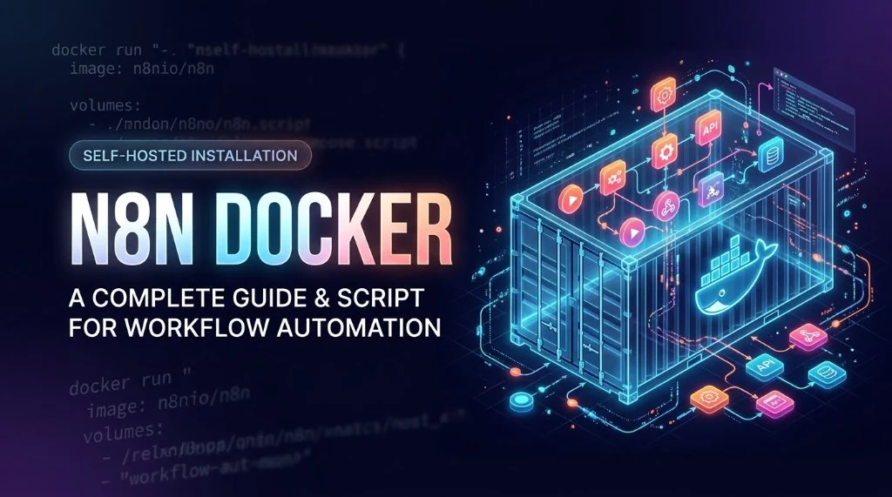

# Universal n8n Docker Stack (`n8n-docker.sh`)

🇺🇸 **English** | 🇧🇷 [Português (BR)](README-ptbr.md) | 🇪🇸 [Español](README-es.md)

[](LICENSE) [](https://github.com/sr00t3d/n8n-docker/releases) [](docker-compose.yml) [](n8n-docker.sh)



Production-ready, panel-agnostic **self-hosted n8n Queue-Mode stack** powered by **PostgreSQL 17**, **Redis 7**, scalable **n8n workers**, and a universal Bash CLI (`n8n-docker.sh`) that works on any Linux server with **Docker Compose** or **Podman Compose**, behind **Nginx**, **Caddy**, **Traefik**, **Cloudflare Tunnel**, **FastPanel**, **CloudPanel**, **Plesk**, **DirectAdmin**, or **cPanel**.

## Key Features

- **Universal & Panel-Agnostic:** zero coupling to a specific control panel; binds n8n safely to `127.0.0.1:5678` (or custom `--port`) behind your reverse proxy of choice (ready-to-use templates in `proxies/nginx.conf` and `proxies/Caddyfile`).
- **Modern Queue-Mode Architecture:** PostgreSQL 17 Alpine (with `pgcrypto` + `uuid-ossp` + non-root app role), Redis 7 Alpine (password-protected + AOF persistence), `n8n` main instance and horizontally scalable `n8n-worker` replicas (`--workers N`), both probed via `healthcheck.js` on `/healthz`.
- **Automated Secret Generation (`--init`):** generates cryptographically strong `N8N_ENCRYPTION_KEY`, PostgreSQL root/app passwords, and `REDIS_PASSWORD` directly into a `chmod 600` `.env` file (`--domain`, `--port`, `--tz`).
- **Full Lifecycle CLI (`n8n-docker.sh`):** `--init`, `--status`/`--preflight` (`-o table|json|csv`), `--up`, `--down`, `--restart`, `--update`, `--logs`, `--backup` (clean, gzipped `chmod 600` PostgreSQL dumps), `--install-systemd --workers <N>`, and `--dry-run`.

## Quick Start

```bash
git clone https://github.com/sr00t3d/n8n-docker.git
cd n8n-docker
chmod +x n8n-docker.sh init-data.sh

# 1. Generate .env with strong random secrets (chmod 600)
./n8n-docker.sh --init --domain n8n.example.com --port 5678 --tz America/Sao_Paulo

# 2. Audit runtime, Compose syntax, .env permissions and configured listen port
./n8n-docker.sh --status

# 3. Start PostgreSQL 17 + Redis 7 + n8n + 2 queue workers
./n8n-docker.sh --up --workers 2

# 4. (Optional) Install portable systemd unit for auto-start on boot
sudo ./n8n-docker.sh --install-systemd --workers 2
```

## Reverse Proxy Templates

- **Nginx / FastPanel / CloudPanel / DirectAdmin / Plesk:** see [proxies/nginx.conf](proxies/nginx.conf) (includes `Upgrade`/`Connection` WebSocket and SSE headers).
- **Caddy (automatic Let's Encrypt HTTPS):** see [proxies/Caddyfile](proxies/Caddyfile).

## Real Output Example

### Stack Preflight & Security Audit (`./n8n-docker.sh --status --no-color`)

```text
=====================================================================
 n8n-docker.sh v2.0.0 | Universal n8n Stack Audit | 2026-11-20T23:59:20Z
=====================================================================
  OS             : AlmaLinux 8.10 (Cerulean Leopard)
  Runtime        : docker (docker compose)
  Compose Config : valid
  RAM / Disk Free: 11688 MB / 19 GB
  .env File      : present (permissions: 600)
  Port 5678      : free
```

### Structured JSON Output (`./n8n-docker.sh --status -o json`)

```json
{
  "tool": "n8n-docker.sh",
  "version": "2.0.0",
  "timestamp": "2026-11-20T23:59:20Z",
  "os": "AlmaLinux 8.10 (Cerulean Leopard)",
  "runtime": "docker",
  "compose_cmd": "docker compose",
  "compose_file_valid": "valid",
  "ram_mb": 11688,
  "disk_free_gb": 19,
  "env_file": "present",
  "env_perms": "600",
  "listen_port": 5678,
  "port_status": "free"
}
```

## License

Licensed under the [Apache License 2.0](LICENSE).
